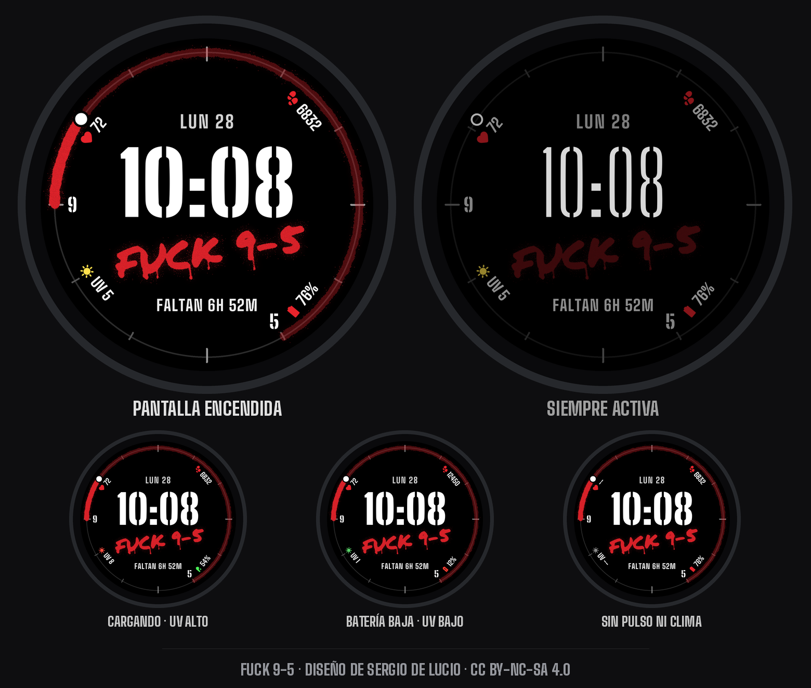

# FUCK 9-5: carátula para Pixel Watch 4



La hora en letra esténcil, el tag en spray y tu jornada de 9:00 a 17:00 marcada en el aro de
12 horas. El arco se va pintando cada 10 minutos conforme avanza el día, y el punto blanco
marca la hora actual. Abajo aparece una cuenta regresiva que cambia según el momento:

| Cuándo | Qué dice |
|---|---|
| Lunes a viernes, antes de las 9 | `ENTRAS EN 1H 20M` |
| Lunes a viernes, de 9 a 17 | `FALTAN 6H 52M` |
| Lunes a jueves, después de las 17 | `LIBRE` |
| Viernes desde las 17, sábado y domingo | `FIN DE SEMANA` |

* **Indicadores en las orillas** (uno por cuarto): arriba a la derecha, pasos. Abajo a la derecha,
  batería: el ícono se pone verde al cargar y rojo con batería baja; al tocarlo abre el estado de la
  batería. Abajo a la izquierda, índice UV, con el sol en el color de la escala de la OMS. Arriba a
  la izquierda, frecuencia cardiaca; al tocarla abre la app de pulso. Si no hay dato, muestran `--`.
* **Personalizar** (mantén presionada la carátula y toca Personalizar):
  * **Color del spray:** rojo, rosa neón, verde neón, amarillo, naranja o blanco.
  * **Modo jefe:** cambia el tag a `F*CK 9–5`.
* **Toques:** la hora abre Alarmas y la fecha abre el Calendario.
* **Formato de hora:** respeta el formato de 12 o 24 horas del reloj.
* **Pantalla siempre activa:** hora delgada, tag atenuado y sin arco. El cambio de modo es
  instantáneo para evitar el error de Wear OS 6 que deja las dos capas encimadas.

## Descargar

Baja el APK de la [última versión](https://github.com/Sergio99778/fuck-9-5-watchface/releases/latest).
El .zip de cada versión trae además la licencia y las instrucciones de instalación.

Funciona en relojes con Wear OS 6 o posterior, como el Pixel Watch 4.

## Autor y licencia

**FUCK 9-5** © 2026 por **Sergio De Lucio** está bajo la licencia
[CC BY-NC-SA 4.0](https://creativecommons.org/licenses/by-nc-sa/4.0/deed.es). Puedes usarla,
compartirla y modificarla gratis dando crédito al autor. No se permite usarla con fines
comerciales, y las versiones modificadas deben compartirse con la misma licencia.

* `LICENCIA.md`: resumen de la licencia y cómo dar crédito.
* `LICENSE`: texto legal completo.
* `TERCEROS.md` y `LICENSES/`: fuentes e íconos de terceros, que conservan su propia licencia.

Las compilaciones oficiales están firmadas por el autor. Huella SHA-256 del certificado:
`97efa9149b89b5e8f079e81c01e1b8de8b9915c92400ac39a083acb698839a48`
(compruébala con `apksigner verify --print-certs`).

## Instalar

Las carátulas que no vienen de Play Store se instalan por depuración inalámbrica (ADB). Entre
paréntesis van los nombres del menú con el reloj en inglés.

1. En el reloj, ve a **Configuración → Sistema → Acerca de → Versiones** (*Settings → System →
   About → Versions*) y toca **Número de compilación** (*Build number*) 7 veces.
2. En **Configuración → Opciones para desarrolladores** (*Developer options*), activa
   **Depuración por ADB** (*ADB debugging*) y **Depuración inalámbrica** (*Wireless debugging*).
   El reloj y la computadora deben estar en la misma red Wi-Fi.
3. Toca **Depuración inalámbrica → Vincular nuevo dispositivo** (*Pair new device*). El reloj
   muestra un código, una IP y un puerto.
4. En la computadora, con las
   [Android SDK Platform-Tools](https://developer.android.com/tools/releases/platform-tools)
   instaladas:

   ```sh
   adb pair IP:PUERTO       # los de "Vincular nuevo dispositivo"; luego escribe el código
   adb connect IP:PUERTO    # los de la pantalla principal de Depuración inalámbrica
   adb install -r FUCK-9-5-watchface-1.2.1.apk
   ```

   El puerto para vincular y el puerto para conectar son distintos.
5. Mantén presionada la carátula actual, desliza hasta el final, toca **+ Añadir** (*+ Add*) y
   elige **FUCK 9-5**.
6. Al terminar, apaga la Depuración inalámbrica, porque gasta batería.

También puedes instalarla desde un teléfono Android con una app que instale por ADB, como
Wear Installer 2 o GeminiMan WearOS Manager.

## Proyecto

* `tools/design95.py`: diseño completo (posiciones, colores, lógica). Genera
  `src/res/raw/watchface.xml`.
* `tools/assets95.py`: pinta las imágenes en spray: el tag, el arco completo y los 48 pedazos
  del progreso. También genera los íconos de los indicadores (Material Symbols).
* `tools/build_fonts.py` y `tools/fonts.json`: generan las fuentes a partir de Big Shoulders y
  Big Shoulders Stencil.
* `tools/preview95.py`: vistas previas generadas desde el propio XML
  (`states`, `colors`, `boss`, `hero`). La de este README está en `docs/preview.png`.
* `build.sh`: compila, alinea, firma y verifica. Usa `AAPT2`, `ANDROID_JAR` y `APKSIGNER`, igual
  que en Orbit. Firma con `keystore/release.jks` y la crea la primera vez. Para firmar con una
  llave que ya tengas, define `KEYSTORE`, `KEY_ALIAS` y `KS_PASS`. La llave del autor no forma
  parte del código, así que tu compilación no se instala encima del APK oficial (desinstala
  primero ese).
* Las herramientas buscan las fuentes originales en `STENCIL_SRC` y `SHOULDERS_SRC` (Big
  Shoulders Stencil y Big Shoulders), `MARKER_FONT` (Permanent Marker) y `SYMBOLS_FONT`
  (Material Symbols Rounded).

## Fuentes e íconos de terceros

* Big Shoulders y Big Shoulders Stencil usan la SIL Open Font License 1.1. Las fuentes
  incluidas son subconjuntos modificados con otro nombre y siguen bajo la OFL.
* El tag se pintó con Permanent Marker (Apache 2.0) y va dentro de la carátula como imagen.
* Los íconos de los indicadores son de Material Symbols Rounded (Apache 2.0).

Los detalles están en `TERCEROS.md` y la carpeta `LICENSES/`.
